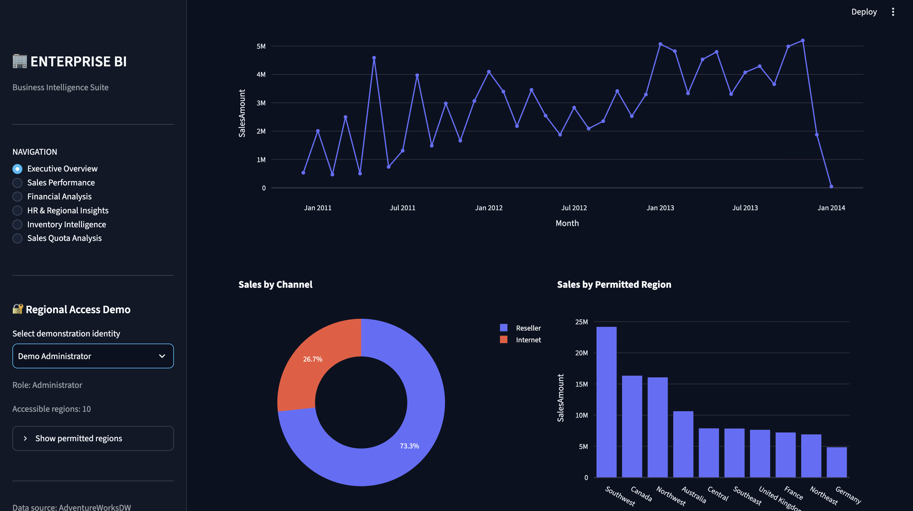
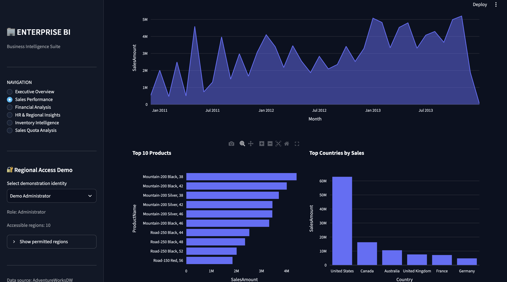
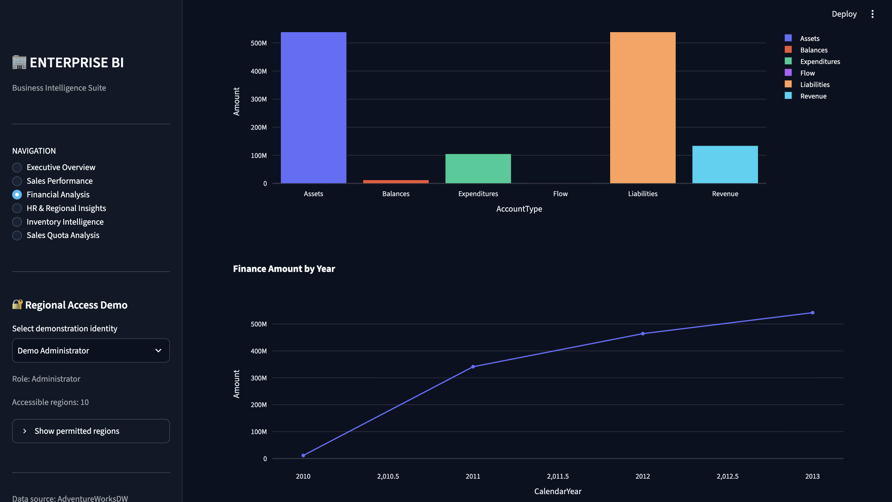
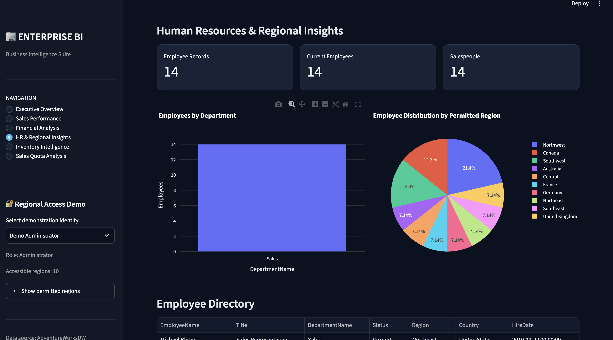
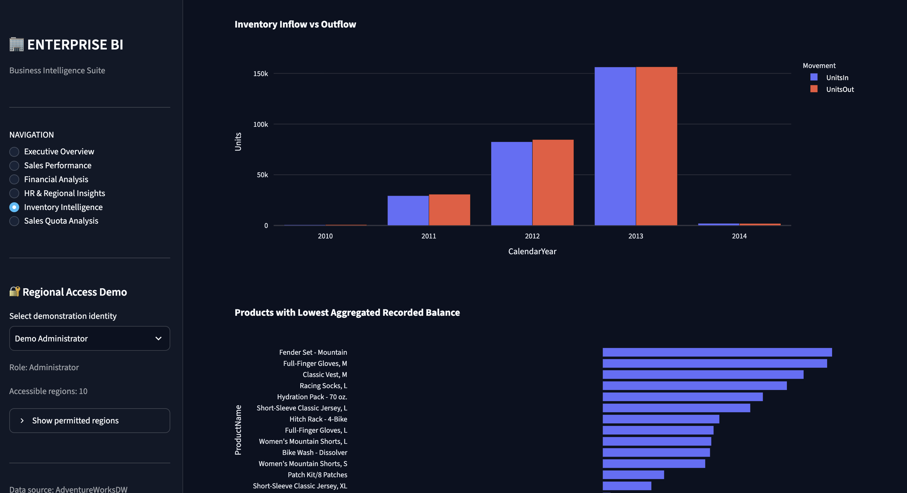
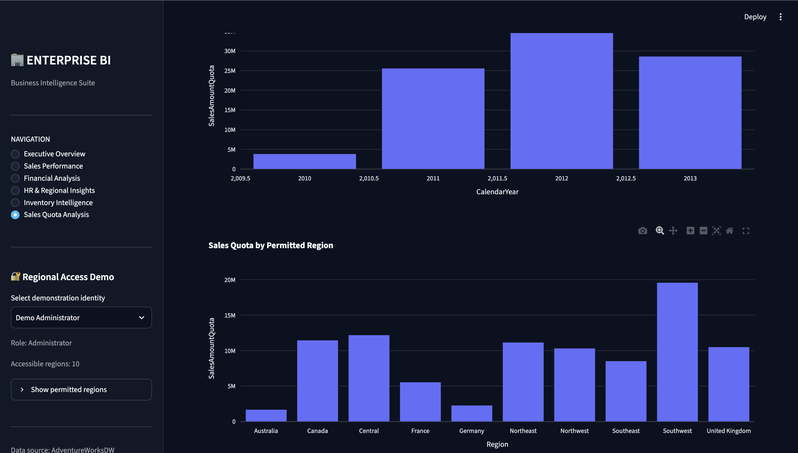

# Enterprise Business Intelligence Suite

An end-to-end Business Intelligence project built using Microsoft AdventureWorksDW sample data, Python, DuckDB, SQL, Streamlit and Plotly.

The project demonstrates how sales, finance, HR and inventory data can be integrated, transformed, validated and presented through an interactive executive dashboard.

> **Implementation note:** The current working implementation uses DuckDB and Python ETL automation as local alternatives. Microsoft SQL Server, Azure Data Factory, Power BI Desktop execution, Power BI Service publishing and production Power BI Row-Level Security remain pending.

## Project Overview

The Enterprise BI Suite brings multiple business functions into one analytical environment.

It provides:
- Executive business performance reporting.
- Sales and revenue analysis.
- Financial performance analysis.
- HR and regional insights.
- Inventory intelligence.
- Sales quota analysis.
- Regional data-filtering demonstration.
- Automated ETL and data-quality validation.

## Technology Stack

| Technology | Purpose |
|---|---|
| Python | ETL and application development |
| DuckDB | Local analytical warehouse |
| SQL | Data modelling and analytical views |
| Pandas | Data manipulation |
| Streamlit | Interactive dashboard |
| Plotly | Interactive visualizations |
| Power Query M | Documented transformation examples |
| DAX | Prepared business intelligence measures |
| Git and GitHub | Version control |

## Architecture

```text
AdventureWorksDW CSV Files
          |
          v
   Python ETL Pipeline
          |
          v
   Schema Validation
          |
          v
   DuckDB Data Warehouse
          |
          v
   SQL Analytical Views
          |
          v
   Data Quality Validation
          |
          v
   Streamlit Dashboard
          |
          v
   Executive Business Insights
```

## Dashboard Modules

The application contains six major sections.

### 1. Executive Overview
A consolidated view of business performance and key indicators.

### 2. Sales Performance
Analysis of sales revenue, sales channels, products and regional performance.

### 3. Financial Analysis
Financial performance and accounting insights.

### 4. HR & Regional Insights
Employee information and regional analysis.

### 5. Inventory Intelligence
Inventory levels, stock balances and inventory valuation.

### 6. Sales Quota Analysis
Employee sales quotas and target-related reporting.

## Dashboard Preview

### Executive Overview


### Sales Performance


### Financial Analysis


### HR & Regional Insights


### Inventory Intelligence


### Sales Quota Analysis


## Data Warehouse

The project uses Microsoft AdventureWorksDW analytical sample data.

The local DuckDB warehouse contains:

- 28 loaded analytical tables.
- 1,047,457 loaded records.
- Five analytical SQL views.
- 41 validated foreign-key relationships.

### Analytical Views

| View | Purpose |
|---|---|
| `vw_sales` | Combined Internet and Reseller sales |
| `vw_finance` | Financial reporting |
| `vw_hr` | Employee and regional reporting |
| `vw_inventory` | Inventory analysis |
| `vw_sales_quota` | Sales quota reporting |

## ETL Pipeline

Run the complete ETL workflow:

```bash
python etl/run_pipeline.py
```

The pipeline executes eight stages:

1. SQL schema extraction.
2. Source schema validation.
3. Warehouse table loading.
4. Row-count verification.
5. Foreign-key relationship validation.
6. Analytical view creation.
7. Analytical view testing.
8. Data-quality checks.

### Latest ETL Results

| Metric | Result |
|---|---:|
| Pipeline stages passed | 8/8 |
| Tables loaded | 28 |
| Records loaded | 1,047,457 |
| Relationships validated | 41/41 |
| Analytical view tests | 7/7 |
| Execution duration | Approximately 2 minutes 48 seconds |

Execution logs are generated in:

`reports/etl_logs/`

## Data Quality

The local data-quality checks cover missing sales amounts, missing dates, finance amounts, employee keys, inventory product keys and quota amounts.

A total of 3,319 negative inventory balances were identified and retained as source-data exceptions for further investigation.

## Regional Access Demonstration

The application includes a local regional filtering demonstration with four configured roles:

- North Manager
- Central Manager
- Europe Manager
- Demo Administrator

The demonstration applies regional filters to supported datasets.

**Security limitation:** This is not production authentication or Power BI Row-Level Security. Finance and inventory data are not region-restricted in the current implementation.

## DAX and Power Query

The repository includes:

- `dax/measures.dax`
- `power_query/power_query_guide.md`

Prepared DAX measures cover sales, costs, profit margins, YTD, YoY growth, rolling averages, finance, inventory, HR and sales quotas.

Power Query documentation includes CSV import, data types, cleaning, duplicate validation, fact and dimension tables, relationships and M-code examples.

These are prepared implementation artifacts; they have not been executed in Power BI Desktop.

## Project Setup

### 1. Clone the repository

```bash
git clone https://github.com/Rupinsa/Enterprise-BI-Suite.git
cd Enterprise-BI-Suite
```

### 2. Create a virtual environment

```bash
python3 -m venv .venv
source .venv/bin/activate
```

### 3. Install dependencies

Install the packages required by the application and ETL scripts:

```bash
pip install -r requirements.txt
```

### 4. Prepare source data

Download the required AdventureWorksDW CSV source files and place them inside:

```text
data/raw/adventureworks/
```

The files should use the expected pipe-delimited format and match the SQL schema definitions.

### 5. Prepare the warehouse

Run:

```bash
python etl/extract_schemas.py
python etl/validate_schemas.py
python etl/load_warehouse.py
```

### 6. Run the ETL pipeline

```bash
python etl/run_pipeline.py
```

### 7. Launch the dashboard

```bash
streamlit run app.py
```

Open the local URL displayed in your terminal, usually:

`http://localhost:8501`

## Repository Structure

```text
Enterprise-BI-Suite/
│
├── .streamlit/
│   └── config.toml
│
├── data/
│   └── raw/
│
├── database/
│   └── schemas.json
│
├── dax/
│   └── measures.dax
│
├── docs/
│   ├── data_quality_report.md
│   └── final_testing_checklist.md
│
├── etl/
│   ├── extract_schemas.py
│   ├── validate_schemas.py
│   ├── load_warehouse.py
│   ├── verify_warehouse.py
│   ├── validate_relationships.py
│   ├── create_views.py
│   ├── test_analytics_views.py
│   ├── data_quality_checks.py
│   └── run_pipeline.py
│
├── power_query/
│   └── power_query_guide.md
│
├── reports/
│   └── foreign_key_definitions.txt
│
├── security/
│   ├── access_control.py
│   └── region_access.json
│
├── sql/
│   └── views/
│       └── create_analytics_views.sql
│
├── tests/
│   └── test_region_access.py
│
├── app.py
├── .gitignore
└── README.md
```

## Implementation Limitations

The following distinctions apply to the current project:

| Requirement | Implementation |
|---|---|
| Local data warehouse | DuckDB |
| Data transformation and loading | Python ETL |
| Analytical modelling | SQL views |
| Interactive reporting | Streamlit |
| Power Query | Documentation and M-code examples |
| DAX | Prepared measures |
| Azure Data Factory | Not implemented |
| Microsoft SQL Server | Not implemented |
| Power BI Desktop | Not executed |
| Power BI Service | Not published |
| Production Power BI RLS | Not implemented |

These limitations are documented transparently.

## Future Enhancements

- Integrate Microsoft SQL Server.
- Implement Azure Data Factory pipelines.
- Execute Power Query transformations in Power BI Desktop.
- Validate DAX measures in Power BI.
- Implement and test production Row-Level Security.
- Publish dashboards to Power BI Service.
- Configure scheduled cloud refresh.

## Project Objective

The objective is to demonstrate practical Business Intelligence skills through data integration, ETL automation, analytical modelling, data validation, regional reporting and interactive business dashboards.

**Project:** Enterprise Business Intelligence Suite  
**Dataset:** Microsoft AdventureWorksDW  
**Focus:** Sales, Finance, HR and Supply Chain Analytics